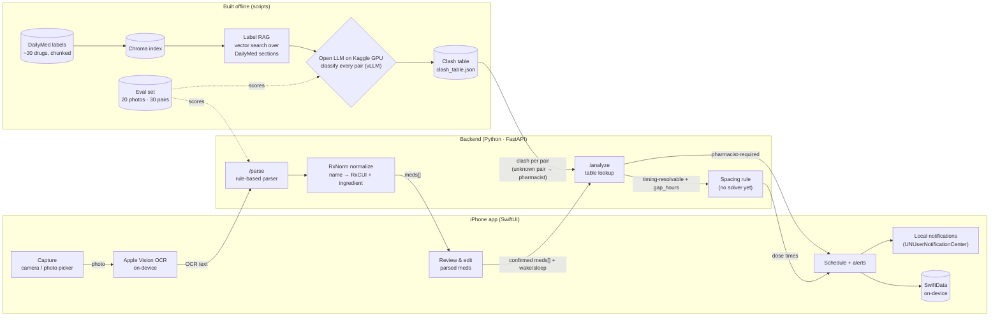

# RxBuddy 2.0 — 24-hour MVP plan

**Goal:** working end to end, once, on a real phone:

> photo of a prescription label → on-device OCR → parsed meds → interactions checked → timing clashes spaced out → local reminders scheduled, with every clash decision citing its source.

**MVP scope = these three outcomes, nothing more:**
1. The iOS app scans a label with on-device OCR and turns it into a daily reminder schedule.
2. A RAG pipeline over FDA labels precomputes drug-interaction rules, so checks are instant and cite their source.
3. Evals measure scanning accuracy and interaction detection (incl. missed dangerous interactions).

Live path is rules only (OCR → rule-based parser → table lookup → spacing rule). The only LLM is an open-source model run offline, once, on a free Kaggle GPU to build the interaction table. No API costs.

Built by one person plus an AI coding agent. The agent writes code; the human owns decisions, review, and anything listed under **"Human owns"**.

---

## 1. Architecture



**Latency design:** the phone does OCR (no photo upload); parsing is regex + RxNorm (no LLM); clash classification runs offline for every pair of the ~30 drugs (435 pairs), so `/analyze` is a lookup. Rationale: [decisions.md](decisions.md) §7.

**Deliberately cut for the MVP** (each is a v2 upgrade with a measurable before/after):
LLM parse fallback, VLM-on-image fallback, model cascade/self-hosting, hybrid BM25 + reranker, DDInter, OR-Tools solver, EventKit calendar, accounts/sync.

---

## 2. Stack and models

| Piece | Choice | Notes |
|---|---|---|
| iOS | SwiftUI, iOS 17+, SwiftData, `PhotosPicker` / camera | 3 screens, no third-party packages |
| OCR | Apple Vision `VNRecognizeTextRequest` (`.accurate`), on-device | free, offline, ~0.1–0.3 s; the eval runs the same OCR on the Mac |
| Backend | Python 3.11, FastAPI, uvicorn, pydantic | run locally; phone hits it over LAN or ngrok |
| Parse | Rule-based: RxNorm fuzzy match per OCR line, regex for strength, phrase map for frequency / food | free, instant, testable; missing field → low `confidence` |
| Classify LLM | Open model on Kaggle (2× T4 or P100, free): Qwen3-14B, 4-bit AWQ, served with vLLM | the only LLM; runs offline in a notebook to build the clash table. Optimizations: [decisions.md](decisions.md) §9. Claude is an optional baseline on the 30 gold pairs only |
| Clash table | `data/clash_table.json`, keyed by sorted ingredient pair | 435 rows, loaded into memory at startup; no database server |
| Embeddings | `BAAI/bge-small-en-v1.5` (local, sentence-transformers) | fast on a laptop; BGE-M3 is the v2 comparison |
| Vector DB | Chroma (persistent, local) | |
| Drug names | RxNav RxNorm REST API (`/approximateTerm`, `/rxcui/{id}/related?tty=IN`) | free, no key. NLM's *interaction* API was retired in 2024 — don't use it |
| Labels | DailyMed web services (SPL by set id) | pull "Drug Interactions", "Dosage and Administration", "Warnings" sections |

---

## 3. Repo layout (target)

```
RxBuddy/
├── ios/RxBuddy/                 # Xcode project (SwiftUI)
│   ├── Models/  (Medication, DoseEvent, ClashAlert)
│   ├── Views/   (CaptureView, ReviewView, ScheduleView)
│   └── Services/(APIClient, OCR, NotificationScheduler)
├── backend/
│   ├── app/
│   │   ├── main.py              # FastAPI routes
│   │   ├── schemas.py           # pydantic models = API contract
│   │   ├── parse.py             # OCR text → rules → meds
│   │   ├── rxnorm.py            # normalization + cache
│   │   ├── rag.py               # Chroma retrieval
│   │   ├── classify.py          # clash classification (offline + eval)
│   │   └── schedule.py          # spacing rule
│   ├── scripts/
│   │   ├── fetch_labels.py      # DailyMed → data/labels/*.json
│   │   ├── build_index.py       # chunk + embed → data/chroma/
│   │   └── build_clash_table.py # export prompts.jsonl → (Kaggle) → verify results → data/clash_table.json
│   ├── notebooks/
│   │   └── classify_kaggle.ipynb # vLLM batch run over prompts.jsonl → results.jsonl
│   ├── eval/
│   │   ├── parse_eval.py
│   │   ├── clash_eval.py
│   │   └── gold/ (photos/, parse_gold.json, pairs_gold.csv)
│   ├── tests/
│   └── pyproject.toml
├── docs/plan/README.md          # this file
└── .gitignore
```

---

## 4. API contract (agent: implement exactly this first)

```http
POST /parse            json: { "ocr_text": "..." }      // Apple Vision output, lines joined by \n
→ 200 { "meds": [Medication], "warnings": [str] }

POST /analyze          json: { "meds": [Medication], "wake": "07:00", "sleep": "23:00" }
→ 200 { "clashes": [Clash], "schedule": [DoseEvent] }
```

```jsonc
// Medication
{ "raw_name": "Synthroid 50mcg", "rxcui": "966222", "ingredient": "levothyroxine",
  "strength": "50 mcg", "frequency_per_day": 1, "with_food": "empty_stomach|with_food|any",
  "confidence": 0.93 }

// Clash
{ "drugs": ["levothyroxine", "calcium carbonate"],
  "type": "timing_resolvable|pharmacist_required",
  "gap_hours": 4,                      // only when timing_resolvable AND stated in source
  "summary": "Take levothyroxine at least 4 hours apart from calcium.",
  "source": { "setid": "...", "section": "Drug Interactions", "quote": "..." } }

// DoseEvent
{ "ingredient": "levothyroxine", "time": "07:00", "note": "empty stomach" }
```

---

## 5. Hard rules (safety + honesty)

1. **No gap without a quote.** `gap_hours` is only set when the retrieved label text states it; the quote is returned and shown in the app.
2. **When unsure, escalate.** If classification confidence is low or retrieval finds nothing, default to `pharmacist_required`, never to "no clash".
3. **Never change doses or drop a medication.** The app only arranges times.
4. **Every clash screen says:** "Not medical advice. Confirm with your pharmacist."
5. **Test data only:** your own bottles or synthetic labels. No other people's prescriptions.

---

## 6. The 24 hours

Times are hour offsets from kickoff (H0). Each block ends with a **checkpoint**; don't start the next block until it passes. Commit at every checkpoint.

### Block A · H0–H2 — Setup and contract
- **Agent:** scaffold `backend/` (FastAPI, pydantic schemas from §4, `/health`, stub `/parse` and `/analyze` returning fixture JSON), `pyproject.toml`, pytest, `.env.example`.
- **Agent:** create Xcode SwiftUI project in `ios/`, models matching the schemas, `APIClient` hitting the stubs.
- **Human owns:** pick the ~30 drugs (include known pairs: levothyroxine+calcium, levothyroxine+iron, ciprofloxacin+antacid, doxycycline+dairy/calcium, warfarin+ibuprofen, sertraline+tramadol, plus safe pairs). Get API key into `.env` (now optional: Claude baseline only).
- ✅ **Checkpoint:** phone app shows stub data from the running backend.

### Block B · H2–H6 — Data and index (backend, can run while iOS work happens)
- **Agent:** `fetch_labels.py` — for each drug, resolve DailyMed set id, download SPL, extract the three sections to `data/labels/{ingredient}.json`.
- **Agent:** `build_index.py` — chunk by section (~300–500 tokens, keep section name + setid as metadata), embed with bge-small, persist Chroma.
- **Agent:** `rxnorm.py` — name → RxCUI → ingredient, with on-disk JSON cache.
- **Human owns:** spot-check 5 labels by eye; write `pairs_gold.csv` (30 pairs: `drug_a, drug_b, expected_type, expected_gap_hours`).
- ✅ **Checkpoint:** `rag.query("levothyroxine", "calcium")` returns the right paragraph in top 3.

### Block C · H6–H10 — Parse
- **Agent:** switch `/parse` to the §4 `ocr_text` contract (schemas, stub, test, iOS `APIClient`). Update `.env.example`: drop `RXBUDDY_MODEL` (the model id lives in the Kaggle notebook); keep `ANTHROPIC_API_KEY` as optional, for the Claude baseline only.
- **Agent:** `parse.py` — rule-based, no LLM: skip noise lines (pharmacy, address, Rx#, prescriber, qty, refills); RxNorm fuzzy match on the remaining lines → drug + ingredient; regex for strength; phrase map for `frequency_per_day` (once daily/QD → 1, twice daily/BID → 2, TID/every 8 hours → 3, …) and `with_food`. Any field not found → `confidence` lowered + a warning, never a guessed value. Unit tests per rule.
- **Human owns:** take ~20 label photos (own bottles + printed synthetic labels; vary angle, glare, blur); write `parse_gold.json`.
- **Agent:** `eval/parse_eval.py` — run Apple Vision OCR on each gold photo on the Mac (same engine as the phone), then parse; field-level accuracy (name, strength, frequency), RxCUI match rate, and latency per photo. Print the worst-failing rule so Block G knows what to fix.
- ✅ **Checkpoint:** parse eval runs and prints a table. Record the number.

### Block D · H10–H12 — Rest / buffer
Sleep or eat. Seriously — the second half goes faster with it. Agent can run long-running fetches here.

### Block E · H12–H16 — Analyze (the core)
- **Agent:** `classify.py` — two halves, no model call inside: `build_prompt(pair)` retrieves top-k chunks from **both** drugs' labels into a fixed prompt asking for `{type, gap_hours, quote, confidence}`; `verify(pair, output)` validates the JSON and enforces rules 1–2 in code: reject any quote that isn't a verbatim substring of the retrieved chunks, and any low-confidence or disagreeing answer, by escalating to `pharmacist_required`.
- **Agent:** `build_clash_table.py export` — every pair of the ~30 drugs → `prompts.jsonl` (gold pairs first, shared instructions first in every prompt so prefix caching works).
- **Agent:** `notebooks/classify_kaggle.ipynb` — load Qwen3-14B AWQ in vLLM (tensor parallel over 2× T4, prefix caching on, JSON-schema guided decoding), 3 samples per pair, write `results.jsonl` plus a timing log. **Human owns:** upload `prompts.jsonl` to Kaggle, run it, download `results.jsonl`.
- **Agent:** `build_clash_table.py import` — majority vote over the 3 samples, `verify()` each pair, write `data/clash_table.json` (sorted pair key; no-clash pairs stored too).
- **Agent:** `/analyze` looks clashes up in the table (loaded once at startup). A pair missing from the table (drug outside the set) → `pharmacist_required` with a "not in our label set" summary, never "no clash"; make `Clash.source` optional for this case only.
- **Agent:** `schedule.py` — spacing rule: place doses evenly between wake/sleep; for each timing clash, shift the second drug forward by `gap_hours`; respect `empty_stomach`; if it doesn't fit before sleep, flag instead of forcing.
- **Agent:** `eval/clash_eval.py` — precision/recall per class, plus the count of **dangerous misses** (`pharmacist_required` predicted as `timing_resolvable` or none). Unit tests for `schedule.py`.
- ✅ **Checkpoint:** `/analyze` on the levothyroxine+calcium fixture returns a 4h-apart schedule with a quote; warfarin+ibuprofen returns `pharmacist_required`. Dangerous misses = 0 on gold set (or understood and documented).

### Block F · H16–H20 — iOS for real
- **Agent:** `CaptureView` (camera + PhotosPicker → Apple Vision OCR on-device → `/parse` with the text; no photo upload), `ReviewView` (editable list, confidence badge, add/remove med, wake/sleep pickers → `/analyze`), `ScheduleView` (timeline by time of day, red clash cards with source quote + pharmacist disclaimer).
- **Agent:** `NotificationScheduler` — request permission, schedule repeating local notifications per `DoseEvent`; persist with SwiftData.
- **Human owns:** read through state management and the API client; you must be able to explain them.
- ✅ **Checkpoint:** full flow on a physical iPhone with a real bottle; a notification fires.

### Block G · H20–H22 — Harden
- Error states (no network, unreadable photo, unknown drug), loading indicators, timeouts.
- Rerun both evals; fix the worst failure category only.
- ✅ **Checkpoint:** 3 clean end-to-end runs in a row.

### Block H · H22–H24 — Ship the story
- Root `README.md`: one-paragraph pitch, the diagram above, setup steps, **results table** (parse accuracy, clash precision/recall, dangerous misses, avg latency, table build time before/after optimizations), limitations, v2 roadmap.
- Record a 60–90 second screen capture of the flow.
- Tag `v2.0-mvp`.

---

## 7. Working with the agent

- Give it **one block at a time**, with the checkpoint as the acceptance test.
- Point it at §4 and §5 on every backend task; those are the contract and the guardrails.
- Ask it to write tests alongside code, and run them before you accept.
- After each block, ask it to explain any part you don't understand. Interview questions will land on `parse.py` rules, `classify.py`, the vLLM optimizations, `schedule.py`, the eval design, and SwiftUI state.

---

## 8. If you fall behind

Cut in this order: notifications persistence → wake/sleep pickers (hardcode) → camera (PhotosPicker only) → parse eval photos 20 → 10.
**Never cut:** the clash eval and the source citations. They are the project.

---

## 9. v2 roadmap (each one = a measured improvement)

1. LLM parse fallback (Claude Haiku 5.5) only for scans where rules leave fields empty → accuracy gain vs. cost per scan.
2. Hybrid BM25 + vector + BGE reranker → report recall@k change.
3. Self-hosted Qwen3-VL / PaddleOCR-VL vs. API → accuracy, cost per scan, latency table.
4. VLM-on-image fallback when OCR text is short or low-confidence → accuracy on curved/glare labels vs. added latency.
5. DDInter as a second interaction source → agreement analysis.
6. OR-Tools scheduler with meal/sleep constraints.
7. EventKit calendar export.

Rationale and the classify/parse ablations (RAG vs. memory vs. full sections, MedGemma, DDInter override, Qwen3-VL): [decisions.md](decisions.md). Deferred work: [TODO.md](TODO.md).
